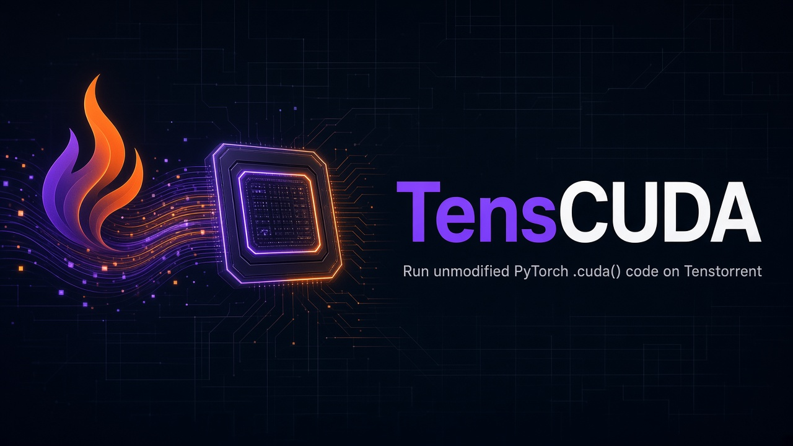
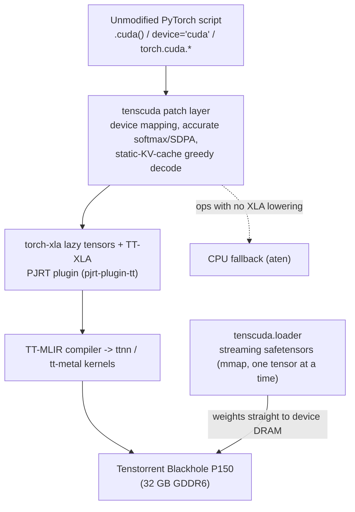

<p align="center">
  
</p>

<h1 align="center">TensCUDA</h1>

<p align="center"><b>Run unmodified PyTorch <code>.cuda()</code> scripts on Tenstorrent Blackhole cards via TT-XLA.</b></p>

<p align="center">
  <a href="LICENSE"></a>
  
  
  
</p>

> **Status: EARLY / EXPERIMENTAL.** It works for the small Llama-family models listed below and has been
> tested on one machine. Expect rough edges.

## Why

Most AI code assumes CUDA, and porting cost is the barrier TensCUDA aims to remove first.
PyTorch is where AI developers and models live: over 150,000 developers and 18,000 organizations work
with it ([PyTorch Foundation](https://pytorch.org/event/webinar-pytorch-a-foundation-for-open-source-ai-ml/)),
and over 70% of AI research implementations use it ([2024 review](https://pytorch.org/blog/2024-year-in-review/)).
Much GPU-targeted PyTorch code uses `.cuda()` and `device="cuda"`. One adapter that runs that
code unchanged opens the door to those users and models on Tenstorrent hardware, without porting each model.
The full business case, goals, milestones (clearly marked as targets) and non-goals are in
**[docs/VISION.md](docs/VISION.md)**. How the adapter is built, why those choices, tradeoffs, and how to
vet the claims: **[docs/ARCHITECTURE.md](docs/ARCHITECTURE.md)**.

TensCUDA is a small Python package. When you `import tenscuda`, PyTorch's CUDA device API
(`torch.cuda.is_available()`, `.cuda()`, `.to("cuda")`, `torch.device("cuda")`, `device="cuda"`
factory kwargs, `torch.cuda.synchronize()`, ...) is redirected to the Tenstorrent device exposed by
[TT-XLA](https://github.com/tenstorrent/tt-xla). It does **not** translate CUDA kernels.

## Quickstart

```bash
uv venv --python 3.12 .venv
# pjrt-plugin-tt pins torch / torch-xla / tt-lang to direct wheel URLs; uv needs them listed explicitly:
uv pip install --python .venv/bin/python \
  --extra-index-url https://pypi.eng.aws.tenstorrent.com/ --index-strategy unsafe-best-match \
  "torch @ https://download.pytorch.org/whl/cpu/torch-2.11.0%2Bcpu-cp312-cp312-manylinux_2_28_x86_64.whl" \
  "torch-xla @ https://pypi.eng.aws.tenstorrent.com/torch-xla/torch_xla-2.9.0%2Bgited8a445-cp312-cp312-linux_x86_64.whl" \
  "tt_lang @ https://pypi.eng.aws.tenstorrent.com/2026-07/tt-lang/tt_lang-1.1.5.dev20260704%2Blight-cp312-cp312-manylinux_2_34_x86_64.whl" \
  pjrt-plugin-tt==1.5.0.dev20260831000501 transformers accelerate pytest
uv pip install --python .venv/bin/python -e .
```

If kernel builds fail with `macro is deprecated provide iptr operands explicitly [-Werror]`,
your system SFPI compiler (`/opt/tenstorrent/sfpi`) is newer than the plugin expects. Put the
matching SFPI (7.69.0 for this plugin) inside the venv instead of changing the system one:

```bash
R=.venv/lib/python3.12/site-packages/pjrt_plugin_tt/tt-metal/runtime
wget https://github.com/tenstorrent/sfpi/releases/download/7.69.0/sfpi_7.69.0_x86_64_debian.txz
tar -xJf sfpi_7.69.0_x86_64_debian.txz -C "$R"     # creates $R/sfpi
```

Then either add one line to your script:

```python
import tenscuda          # before your own torch code
import torch
model = model.cuda()     # now lands on the Tenstorrent card
```

or leave the script untouched and launch it through TensCUDA:

```bash
python -m tenscuda examples/tinyllama_generate.py --model TinyLlama/TinyLlama-1.1B-Chat-v1.0
```

`examples/tinyllama_generate.py` is a plain CUDA-style Hugging Face script with no TensCUDA code in it.

To load models bigger than host RAM, stream weights straight to the card:

```python
from tenscuda.loader import load_causal_lm
model = load_causal_lm("TinyLlama/TinyLlama-1.1B-Chat-v1.0")   # meta skeleton + per-tensor upload
```

## Tested on

| | |
|---|---|
| Card | Tenstorrent Blackhole P150a (one card) |
| Host (current) | **`tens`** — Ubuntu 24.04, **AMD Ryzen 7 9700X**, **~30 GiB RAM**, Gigabyte B850, KMD 2.11.0, Secure Boot off — [HARDWARE_BASELINE.md](docs/HARDWARE_BASELINE.md) |
| Host (legacy) | **`rock`** — i7-6700, 8 GB — historical matrix through Nov 2025 |
| System stack | tt-metal v0.82, KMD 2.11.0, firmware bundle 18.10.0 |
| Python stack | Python 3.12, torch 2.11.0+cpu, torch-xla 2.9.0 (TT build), pjrt-plugin-tt 1.5.0.dev20260831, transformers 5.17.0 |

## Results (measured, one P150a)

Greedy decoding, chat prompt "Explain in two sentences why the sky is blue." (40-46 prompt
tokens), 32 new tokens. "Warm" is after the first run has compiled. Full details are in
[docs/PERF.md](docs/PERF.md).

| Model | dtype | Tokens vs CPU | TT warm decode | TT first run (incl. compile) | CPU (same host) |
|---|---|---|---|---|---|
| SmolLM2-135M-Instruct | fp32 | 32/32 identical to CPU fp32 | 3.8 tok/s | 99 s | 15 tok/s |
| SmolLM2-135M-Instruct | bf16 | 32/32 identical to CPU fp32 (*) | 3.6 tok/s | 50-67 s | 16.7 tok/s |
| TinyLlama-1.1B-Chat | bf16 | 32/32 identical to CPU fp32 and CPU bf16 | 3.9-4.5 tok/s (about 4.2) | 36-57 s (about 41 s) | 5.5 tok/s bf16, 3.0 tok/s fp32 |

(*) CPU bf16 itself differs from CPU fp32 at token 30 (a logit tie smaller than one bf16 step);
TensCUDA bf16 matches the fp32 reference there.

| Loader | Peak host RSS after load (TinyLlama, 2.05 GiB of weights) |
|---|---|
| `tenscuda.loader.load_causal_lm` (streaming) | 0.68 GiB |

Process peak RSS later reaches about 2.5 GiB, mostly from graph compilation, not weights.

Other checks (all in `tests/`, 18 passing on the P150a):
- Host to device to host transfers are bit-exact for fp32, bf16, int32 and int64.
- fp32 matmul error is about 1.2e-3 relative L2, so it behaves like TF32 on Nvidia GPUs, not true fp32.
- Ops without an XLA lowering run on the CPU. For example, `torch.unique` and `torch.nonzero` run as
  `aten::_unique2` and `aten::nonzero` fallbacks.

**Compatibility matrix (Nov 2026):** 12 models from 135M through **Llama-3.1-8B** (M2 phi3/gemma2
complete; 8B loads on a 8 GB host with **0.55 GiB** peak anon RSS, ~3.0 tok/s warm decode).
See [docs/COMPATIBILITY.md](docs/COMPATIBILITY.md).

## How it works



## What TensCUDA fixes beyond device mapping

- **Accurate softmax/attention.** On this stack the fused TT softmax has about 2.3e-2 relative
  error, and the error is the same in fp32. TensCUDA emits `exp(x - max) * (1/sum)` and a matching
  SDPA, which cuts the error to 2.8e-4 for softmax and 1.7e-3 for SDPA. Without this fix,
  SmolLM2 diverged from the CPU after 2 tokens; with it, all 32 match. Disable it with
  `TENSCUDA_EXACT_SOFTMAX=0`.
- **Fixed-shape decoding.** Stock HF `generate` grows `input_ids` every step, which forces one
  TT compile per token. On TT, greedy `generate` is routed to a static-KV-cache loop with
  one prefill graph and one reused decode graph.
- **Compile options.** HiFi4 math with fp32 accumulation is the default
  (`TENSCUDA_MATH_FIDELITY`, `TENSCUDA_FP32_ACC`).
- `fp16` is mapped to `bf16` on the device (`TENSCUDA_FP16_TO_BF16=0` to disable).

## Compatibility matrix

Per-model status, parity, speed, compile time and memory are in **[docs/COMPATIBILITY.md](docs/COMPATIBILITY.md)**.
The `torch.cuda.*` shim surface (Y / STUB / N) is in **[docs/API_COMPATIBILITY.md](docs/API_COMPATIBILITY.md)**.
Set `TENSCUDA_MIGRATION_LOG=1` for an exit summary of mapped vs stub API touches.
Add a model with one command: `python scripts/matrix.py <hf-model-id>`.

## M4 benchmark environment (decode speed)

Default generate keeps full torch-function modes for parity. For **measured decode speed** on a
P150 (validated on SmolLM2, TinyLlama, Llama-3.2-1B — see [docs/DAY_REPORT_2026-11-22.md](docs/DAY_REPORT_2026-11-22.md)):

```bash
# A/B table (3 models or one model id)
PYTHONPATH=. .venv/bin/python scripts/m4_pause_compare.py

# Single-model probe (writes results/m4_replay_probe_<slug>_pause.json)
TENSCUDA_DECODE_PAUSE_MODES=1 PYTHONPATH=. .venv/bin/python scripts/m4_replay_probe.py \
  HuggingFaceTB/SmolLM2-135M-Instruct 32
```

Optional thin forward (`TENSCUDA_THIN_DECODE=1`) and loader CPU prefetch (`TENSCUDA_LOADER_PREFETCH=1`)
are experimental — run `scripts/m4_pause_parity_gate.py` after changes. Shape buckets and JIT cache:
[docs/COMPILE_AND_SHAPES.md](docs/COMPILE_AND_SHAPES.md). Host records: [docs/HARDWARE_BASELINE.md](docs/HARDWARE_BASELINE.md).

Matrix rows can record pause delta: `python scripts/matrix.py MODEL --pause-benchmark`.

## Card monitor (Ubuntu)

A GNOME System Monitor–style live view of the Tenstorrent card (temperature, power, AI clock,
host memory) plus the current TensCUDA workload when a bench/load is running.

**Install from the `.deb`** (Ubuntu 24.04):

```bash
sudo apt install ./dist/tenscuda-monitor_0.1.0_all.deb
# rebuild: bash scripts/build_monitor_deb.sh
```

Or from a git checkout without the package:

```bash
sudo apt install python3-gi python3-gi-cairo gir1.2-gtk-4.0 gir1.2-adw-1
bash scripts/install_monitor_on_host.sh
```

Then open **TensCUDA Monitor** from Activities, or run `tenscuda-monitor`. See [packaging/README.md](packaging/README.md).

## Benchmark your card

A speedtest-style standard benchmark: fixed prompt, 32 new tokens, greedy decoding, seed 0,
bf16 weights, 1 cold + 3 warm runs, plus a CPU parity check.

```bash
python -m tenscuda bench                       # SmolLM2-135M (default)
python -m tenscuda bench --model tinyllama --quick
python -m tenscuda bench --list                # standard models
```

It prints a summary card with warm tok/s, first-run and compile time, first-token latency,
CPU parity (pass, near-tie or fail), peak host RAM, card temperature and power, and the detected
config (card, firmware, KMD, pjrt-plugin-tt, torch, CPU, RAM, OS, TensCUDA commit).

**Nothing is uploaded.** The result JSON (schema `tenscuda-bench/1`) has hostnames, usernames,
paths and IP addresses removed. It's printed in full, then written only after you confirm (or pass
`--yes`). To share it, paste it into a [Benchmark result](https://github.com/jaxily/tenscuda/issues/new?template=benchmark-result.yml)
issue, or open a PR adding it to `benchmarks/results/`. The [leaderboard](docs/LEADERBOARD.md) is
generated from those files by `python scripts/build_leaderboard.py`.

## Honest limits

- **Slower than the CPU on tiny models.** Decoding is host-bound: torch-xla re-traces the
  Python model every token (about 0.25 s per step on a 2015-era 4-core CPU), while the card
  itself is busy for only about 6% of the step. Small models are therefore slower than running
  them on the CPU. Llama-3.1-8B still decodes at about **3.0 tok/s** warm on this host (see matrix).
- **Quantization is experimental.** `tenscuda.quant.quantize_weights(model, "bfp_bf8")` uses
  TT-XLA's weight-dtype pass. On TinyLlama, bfp8 keeps 32/32 token parity and bfp4 is clearly
  lossy (87.9% argmax agreement). Device-memory savings are **not** verified, and speed doesn't
  change. Switching dtypes inside one process reuses stale cached graphs. See docs/PERF.md section 7.
- **Single card only.** Multi-card / two-P150 tensor parallelism isn't implemented.
- **No CUDA extensions.** flash-attn, bitsandbytes, xformers, custom CUDA kernels, Triton
  kernels and most ComfyUI custom nodes are unsupported.
- `torch.compile(backend="tt")` and multi-step fused decode graphs currently produce **wrong
  tokens** with HF's StaticCache, so they are off by default. See docs/PERF.md.
- Batch size 1, greedy decoding only on the fast path. Sampling and beam search fall back to
  stock HF `generate`, which recompiles every token.
- `torch.cuda` memory statistics are stubs that return 0.

## Tests

```bash
python -m pytest -q tests/       # needs a Tenstorrent card; skips otherwise
python scripts/op_parity.py      # per-op error table -> results/op_parity.json
```

## Roadmap

1. Graph replay for decode (no per-token Python re-trace), the main speed lever — [docs/M4.md](docs/M4.md).
2. Token parity on 8B+ without a host CPU reference; verified bfp8/bfp4 **device** memory savings.
3. Native-kernel swaps (matmul, SDPA, RMSNorm, rotary) where TT-XLA is slow.
4. Sampling (top-k/top-p) on the fast path.
5. Two-card (2x P150) model splitting.
6. Encoder (BERT-style) and vision model coverage.

## Contributing

Compatibility reports, bug reports and PRs are welcome. See [CONTRIBUTING.md](CONTRIBUTING.md) and the
"Model compatibility report" issue template. Every number in this repo has to come from a committed measurement.

## License

Apache-2.0. See [LICENSE](LICENSE).

---

TensCUDA is an unofficial community project and is not affiliated with or endorsed by Tenstorrent Inc.
