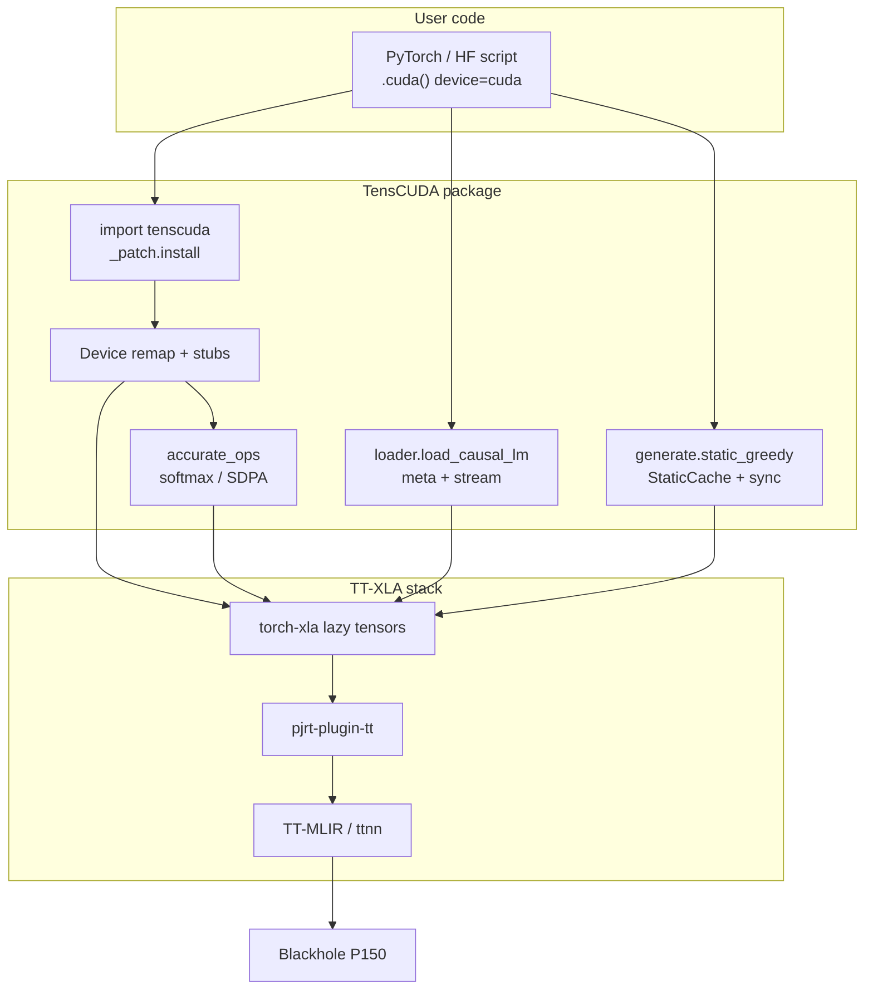
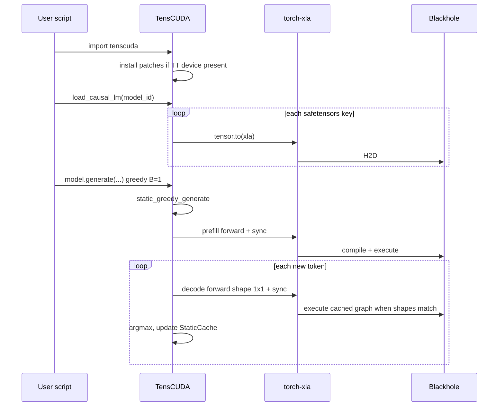
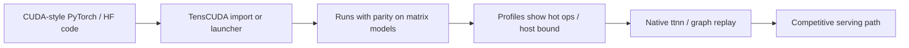

# TensCUDA architecture

> Engineer-facing design document: how the system works, why this approach, tradeoffs, and how to vet the claims. Product thesis and milestones: [VISION.md](VISION.md). Measured evidence: [PERF.md](PERF.md), [COMPATIBILITY.md](COMPATIBILITY.md). API surface: [API_COMPATIBILITY.md](API_COMPATIBILITY.md).

**Status:** early / experimental. Validated on one Blackhole P150a + 8 GB host. Numbers below are from committed measurements unless marked as targets.

---

## 1. Executive summary

TensCUDA is a thin PyTorch **device-API adapter**, not a CUDA emulator.

| Layer | Role |
|---|---|
| User script | Calls `.cuda()`, `device="cuda"`, `torch.cuda.is_available()`, HF `generate` |
| TensCUDA | Remaps that surface onto an XLA/TT device; fixes numerics and decode shape |
| TT-XLA | `torch-xla` + `pjrt-plugin-tt` compile and run graphs on the card |
| Hardware | Tenstorrent Blackhole (e.g. P150, 32 GB GDDR6) |

**Thesis:** the first adoption barrier for a new accelerator is *porting cost*, not peak FLOPs. Most AI code treats CUDA as a *device* (move tensors, check availability, synchronize), not as a kernel language. Remap that device API once; let an existing compiler (TT-XLA) lower the graphs. Every working model becomes a matrix row, a regression test, and a demand signal for native kernels.

**What success looks like today (measured):**

- Unmodified HF causal-LM scripts run via `import tenscuda` or `python -m tenscuda script.py`.
- Greedy token parity vs CPU through **Llama-3.1-8B** (32/32 on the matrix prompt) with a streaming loader that keeps host anonymous RSS on the order of **~0.5 GiB** after load on an 8 GB machine.
- Op-level and end-to-end correctness work documented with repros (fused softmax, factory wrapping, decode sync).

**What success is *not* yet:** competitive tok/s vs NVIDIA CUDA, multi-card, CUDA graphs/extensions, or production serving.

---

## 2. System context



**Boundary rule:** TensCUDA owns the *PyTorch CUDA device contract* (and a few HF decode knobs required for correct/compilable graphs). It does **not** own kernels, memory allocators, or the compiler. Ops TT-XLA cannot lower fall back to host CPU via torch-xla's aten path.

---

## 3. Component design

### 3.1 Install path (`tenscuda/__init__.py` → `_patch.install`)

On import:

1. Probe `torch_xla.runtime` for device count and type `TT`.
2. If absent or wrong type → **no-op** (leave `torch` untouched; log a warning).
3. Otherwise install patches in order:
   - `torch.cuda.*` mapped or stubbed ([`api_status.py`](../tenscuda/api_status.py))
   - `Tensor` / `Module` `.cuda()` / `.to(...)` device remaps
   - `_CudaDeviceMode` (`TorchFunctionMode`) for factory `device="cuda"` kwargs
   - `torch.device` proxy metaclass (`"cuda"` → XLA device)
   - Optional HF `GenerationMixin.generate` fast path (StaticCache greedy)
   - Default compile options: HiFi4 + fp32 destination accumulation

Uninstall restores originals (tests).

### 3.2 Device remapping (`_patch.py`)

| Mechanism | Why this design |
|---|---|
| **`TorchFunctionMode` for factories** | Wrapping `torch.zeros` etc. in Python broke `with torch.device(...)` context (keyed on builtins) and silently corrupted HF init. Mode rewrites kwargs without replacing builtins. |
| **Proxy `torch.device`** | Scripts construct `torch.device("cuda")`; proxy returns XLA. Around `torch.compile`, `real_torch_device` restores the real class so FX codegen does not emit unbound `device(...)`. |
| **fp16 → bf16 (default)** | TT path prefers bf16; optional via `TENSCUDA_FP16_TO_BF16=0`. |
| **Stubs for streams / events / memory stats** | Keep scripts from crashing; semantics incomplete. Status codes `Y` / `STUB` / `N` are the honesty contract ([API_COMPATIBILITY.md](API_COMPATIBILITY.md)). |

Migration logging (`TENSCUDA_MIGRATION_LOG`) records first touch of mapped vs stub vs unsupported APIs.

### 3.3 Numerics overrides (`accurate_ops.py`)

Measured on P150a: fused TT softmax ~**2.26e-2** relative L2 vs CPU fp32; the pattern `exp/sum` is matched into the same fused op. TensCUDA emits `exp(x-max) * reciprocal(sum)` (~**2.76e-4**) and a matching SDPA path. Disable with `TENSCUDA_EXACT_SOFTMAX=0`.

**Design choice:** prefer token parity over calling the faster fused kernel until the compiler kernel is fixed or routed natively.

### 3.4 Streaming loader (`loader.py`)

Problem: `from_pretrained(...).cuda()` materializes the full model in host RAM (bf16 8B ≈ 16 GB; reference host has 8 GB).

Solution:

1. Build module skeleton on **`meta`** (no storage).
2. Memory-map safetensors shards; cast and `.to(device)` **one tensor at a time**.
3. `torch_xla.sync()` between shards; rebuild non-persistent buffers (e.g. rotary `inv_freq`) on CPU then move.
4. Report **RssAnon** (not only VmHWM): file-backed page cache inflates VmHWM during first execute but is reclaimable.

This is the load path used by the compatibility matrix and is the enabler for “big model / small host.”

### 3.5 Decode path (`generate.py` + HF patch)

Stock HF `generate` grows shapes every token → new TT-MLIR compile every step (catastrophic).

Fast path (batch 1, greedy, supported kwargs):

1. Prefill once; then single-token decode with **StaticCache**.
2. **`torch_xla.sync()` after each forward** — batching multiple decode steps in one lazy graph corrupts StaticCache (see `scripts/kv_diagnose.py`: 8/8 parity per-step sync vs 3/8 multi-forward lazy).
3. Fall back to stock HF generate (with static cache hint) when sampling/beams/unsupported kwargs appear; log that this will recompile.

`torch.compile(backend="tt")` remains off by default: wrong tokens with StaticCache ([PERF.md](PERF.md)).

### 3.6 Supporting modules

| Module | Role |
|---|---|
| `cuda_stubs.py` | Dummy Stream/Event; memory_info stubs |
| `quant.py` | Experimental bfp8/bfp4 weight annotations via TT-XLA |
| `bench.py` / `scripts/matrix.py` | Reproducible measurement → matrix / leaderboard |
| `resident.py` / `decode_graph.py` | M4 experiments (graph replay / resident IO) |

---

## 4. Control and data flow (typical HF generate)



---

## 5. Design decisions: logic, pros, cons

### D1 — Device-API adapter, not PTX/CUDA kernel translation

- **Logic:** Matches how most HF/tutorial code uses CUDA; reuses TT-XLA investment; small maintainable surface.
- **Pros:** Fast path to many models; clear non-goals; upstreamable findings.
- **Cons:** flash-attn, bitsandbytes, Triton, custom CUDA extensions never work; not a drop-in for CUDA-heavy apps (ComfyUI nodes, etc.).

### D2 — Honesty codes (`Y` / `STUB` / `N`) instead of silent fakes

- **Logic:** Scripts often probe capability; crashing or lying both destroy trust. Stubs survive probes; docs state incomplete semantics.
- **Pros:** Engineer can audit surface in one table; migration log shows real touch patterns.
- **Cons:** Memory/stream stubs can hide real resource bugs until runtime OOM on device.

### D3 — TorchFunctionMode over wrapping factories

- **Logic:** Empirical: wrappers corrupted HF init (first SmolLM token 504→1).
- **Pros:** Correct under `torch.device` contexts; one place for softmax override + device rewrite.
- **Cons:** Global mode for process lifetime; must be careful with nested modes / tests (`uninstall`).

### D4 — Exact softmax/SDPA by default

- **Logic:** Fused kernel error (~2e-2) breaks greedy parity; reciprocal form avoids pattern match.
- **Pros:** Matrix parity claims are real; disable flag for A/B.
- **Cons:** Extra ops vs fused kernel; may leave performance on the table until native accurate kernels exist.

### D5 — Sync-per-token decode + StaticCache

- **Logic:** Correctness constraint of current TT-XLA + HF cache interaction; measured.
- **Pros:** Stable graphs after warmup; parity; predictable compile counts (~8 graphs for many Llama-like models).
- **Cons:** Host Python re-trace still dominates step time (~75–100 ms trace + ~160–180 ms sync/execute on SmolLM2-135M); M4 must remove re-trace without violating the one-sync-per-forward rule.

### D6 — Streaming meta loader as first-class API

- **Logic:** Host RAM is the practical ceiling for trying large models on developer boxes.
- **Pros:** 8B on 8 GB host; RssAnon is the right success metric.
- **Cons:** Model-specific buffer rebuild; not all architectures auto-supported; first-touch page cache still spikes VmHWM.

### D7 — Compatibility matrix as the product surface

- **Logic:** “Works” means parity + speed + RSS + compile, not a marketing checkbox.
- **Pros:** Vettable; every PR can add a row; doubles as TT-XLA demand signal.
- **Cons:** Expensive to run; single-host bias until others contribute; near-ties need careful interpretation (logit margins).

---

## 6. Why this can succeed (and what “success” means)

### 6.1 Adoption funnel (intended)



TensCUDA wins the **onramp** layer (C). Tenstorrent (or contributors) win the **performance** layer (E→F). The architecture deliberately separates those so the adapter stays small and the compiler/kernel teams get concrete workloads.

### 6.2 Evidence already in-repo

| Claim | Where to verify |
|---|---|
| Device remap works for HF scripts | Examples + matrix rows in [COMPATIBILITY.md](COMPATIBILITY.md) |
| 8B fits small host | Llama-3.1-8B row: ~0.52 GiB anon after load |
| Parity is measured, not asserted | Token match + teacher-forced top-1 in matrix JSON under `results/` |
| Softmax fix is necessary | [PERF.md](PERF.md) §2–3; `scripts/op_parity.py` |
| Decode sync constraint | `scripts/kv_diagnose.py`; [M4.md](M4.md) |
| Speed bottleneck is host+compile, not “card is slow” | `scripts/trace_cost.py`; PERF split ~6% device busy on tiny models |

### 6.3 Why an engineer should trust the procedure

1. **Falsifiable milestones** in VISION (M1–M7) — done only when numbers land in PERF/COMPATIBILITY.
2. **Non-goals written down** — no PTX, no “faster than CPU on tiny models today,” no replacement for native tt-metal/vLLM paths.
3. **Bugs attributed to stack layers** with minimal repros — adapter vs fused op vs graph cache vs StaticCache.
4. **Near-tie policy** — divergence only where CPU top-2 logits are within ~0.25 is labeled precision, not success theater.

### 6.4 Risks and mitigations

| Risk | Impact | Mitigation |
|---|---|---|
| Host-bound decode forever | Adapter looks “slow forever” | M4 graph replay + native kernels ([M4.md](M4.md)); faster host for measurement |
| TT-XLA / plugin churn | Breaks install or numerics | Pin wheels in README; isolate venv; SFPI version note |
| Silent stub misuse | Wrong memory conclusions | API_COMPATIBILITY + migration log; prefer RssAnon monitors |
| Scope creep into full CUDA | Unmaintainable | Hard N for extensions/graphs/amp |
| Single-machine overfitting | Matrix not general | CONTRIBUTING invites external `matrix.py` rows |
| `torch.compile` / fused multi-step | Wrong tokens | Off by default; diagnose scripts before enable |

---

## 7. Failure modes (operational)

| Symptom | Likely cause | First check |
|---|---|---|
| Tokens diverge from CPU early | Softmax override off; wrong fidelity; dtype | `TENSCUDA_EXACT_SOFTMAX`; HiFi4/fp32 acc; teacher-forced parity |
| First token wrong / HF init broken | Factory wrapping / device context | Ensure TensCUDA mode path, not custom wrappers |
| Compile every token / step time grows | Dynamic shapes or missing sync | Fixed-shape generate; `torch_xla.sync` per step |
| OOM on 8 GB host during load | Full `from_pretrained` to CPU | Use `load_causal_lm` streaming path |
| Kernel build `-Werror` SFPI | System SFPI newer than plugin | Venv-local SFPI 7.69.0 (README) |
| Quant change ignored | Graph cache / missing parameter mark | Fresh process; PERF §7 |

---

## 8. Verification procedure (how to vet us)

Run on a Blackhole host with the pinned stack from the README.

```bash
# Unit / integration (skips without card)
python -m pytest -q tests/

# Op-level numerics
python scripts/op_parity.py

# End-to-end matrix row (CPU ref + TT stream + parity)
python scripts/matrix.py HuggingFaceTB/SmolLM2-135M-Instruct --new-tokens 32

# Decode correctness constraint
python scripts/kv_diagnose.py HuggingFaceTB/SmolLM2-135M-Instruct 8

# Host vs device step split
python scripts/trace_cost.py HuggingFaceTB/SmolLM2-135M-Instruct default
```

Accept a claim only if: (1) JSON under `results/` matches the doc table, (2) parity definition matches COMPATIBILITY header, (3) environment pins match PERF header (or differences are noted).

---

## 9. Package map

| Path | Responsibility |
|---|---|
| [`tenscuda/__init__.py`](../tenscuda/__init__.py) | Version; call `install`; export `device` / `sync` |
| [`tenscuda/_patch.py`](../tenscuda/_patch.py) | CUDA remap, mode, HF generate hook, compile options |
| [`tenscuda/accurate_ops.py`](../tenscuda/accurate_ops.py) | Softmax / SDPA overrides |
| [`tenscuda/loader.py`](../tenscuda/loader.py) | Meta skeleton + safetensors stream + RSS helpers |
| [`tenscuda/generate.py`](../tenscuda/generate.py) | Fixed-shape greedy decode |
| [`tenscuda/api_status.py`](../tenscuda/api_status.py) | Y/STUB/N source of truth |
| [`tenscuda/cuda_stubs.py`](../tenscuda/cuda_stubs.py) | Stream/Event/memory stubs |
| [`tenscuda/quant.py`](../tenscuda/quant.py) | Experimental weight dtype |
| [`tenscuda/__main__.py`](../tenscuda/__main__.py) | Launcher: patch then `runpy` user script |
| [`scripts/matrix.py`](../scripts/matrix.py) | Compatibility matrix generator |
| [`docs/M4.md`](M4.md) | Active performance experiment queue |

---

## 10. Related documents

| Doc | Contents |
|---|---|
| [VISION.md](VISION.md) | Thesis, business case, milestones, non-goals, ask to Tenstorrent |
| [COMPATIBILITY.md](COMPATIBILITY.md) | Per-model parity / tok/s / RSS (generated) |
| [API_COMPATIBILITY.md](API_COMPATIBILITY.md) | torch.cuda surface status (generated) |
| [PERF.md](PERF.md) | Learnings log, op tables, M4 measurements |
| [M4.md](M4.md) | Graph replay / native kernel experiment plan |
| [LEADERBOARD.md](LEADERBOARD.md) | Bench JSON rollup |
| [CONTRIBUTING.md](../CONTRIBUTING.md) | How to add matrix rows without lying |

---

TensCUDA is an unofficial community project and is not affiliated with or endorsed by Tenstorrent Inc.
