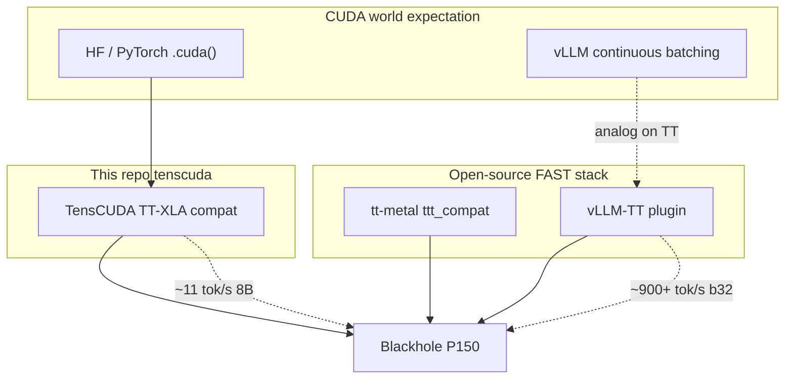

# CUDA → open-source Metal (aggregate serving)

**Audience:** engineers coming from NVIDIA CUDA + vLLM who want **~900–1079 tok/s aggregate**
on one Tenstorrent Blackhole P150 — not the TensCUDA HF compat path.

## Honest boundary

| What you have | What runs | Typical Llama-8B throughput |
|---|---|---:|
| Unchanged HF script with `.cuda()` | **TensCUDA** → TT-XLA | **~11 tok/s** batch-1 (~4× CPU) |
| Same model, **open-source** stack | **tt-metal** `ttt_compat` batch-32 | **~1079 tok/s** aggregate (~354× CPU) |
| CUDA-style **serving** | **vLLM-TT** on tt-metal (`vllm-tt-plugin`) | **~909 tok/s** offline b32 (~300× CPU) |

TensCUDA **does not translate CUDA kernels** and **does not embed** tt-metal or vLLM inside
`import tenscuda`. Aggregate serving needs the **native** repos:

- [tt-metal](https://github.com/tenstorrent/tt-metal) (open-source C++/ttnn)
- [vllm-tt-plugin](https://github.com/tenstorrent/vllm-tt-plugin) (OpenAI-compatible serve on TT)

This repo **routes you there**: setup scripts, card hygiene, benchmarks, and committed
`results/*.json` — not a hidden TT-XLA fast path.



## One command (card host)

Prereq: [TT_METAL_FASTPATH.md](TT_METAL_FASTPATH.md) (`~/tt-metal` built, `~/vllm-tt-plugin`
installed in **metal venv only** — never mix with `tenscuda/.venv`).

```bash
cd ~/tenscuda
export HF_MODEL=unsloth/Meta-Llama-3.1-8B-Instruct
# Full aggregate proof: metal pytest + vLLM offline + optional serve bench
bash scripts/run_fast_aggregate_measure.sh

# Serving only: OpenAI API on :8000, then optional bench
bash scripts/run_tt_serve_fast.sh              # serve (32 concurrent seqs)
bash scripts/run_tt_serve_fast.sh --bench        # serve + vllm bench serve
```

**Card rule:** one job at a time. Scripts call `scripts/lib/card_hygiene.sh` to stop TensCUDA
matrix and stale `server_example_tt.py` before native runs.

## If vLLM dies after metal (`EngineDeadError`)

Metal pytest and vLLM offline both touch the same device. If offline or serve fails after metal:

1. Run hygiene only: `bash -c 'source scripts/lib/card_hygiene.sh; card_hygiene'`
2. Run **vLLM alone** (skip metal):

   ```bash
   bash scripts/run_tt_speed_showcase.sh --skip-metal
   # or
   bash scripts/run_tt_serve_fast.sh --bench
   ```

3. Export logs: `python scripts/export_vllm_offline_json.py /tmp/vllm_offline_b32_speed.log`
   and `python scripts/export_vllm_serve_json.py /tmp/vllm_bench_8b.log`

## Mental model for CUDA developers

| CUDA / NVIDIA habit | Tenstorrent equivalent |
|---|---|
| CUDA Graphs / cuBLAS | tt-metal trace + ttnn kernels |
| vLLM `max_num_seqs` / continuous batching | vLLM-TT `max_num_seqs` / `max_seqs_in_batch` |
| `torch.cuda` + HF generate | TensCUDA (compat only for arbitrary models) |
| Peak tok/s on one GPU | **vLLM-TT or metal batch-32** on one P150 |

Do **not** expect `import tenscuda` + `model.generate()` to reach vLLM-class aggregate throughput;
that is by design ([SPEED_RESEARCH.md](SPEED_RESEARCH.md)).

## Fast vs compat split (tested)

| `TENSCUDA_FAST` | Allowlisted model | `generate()` on TT-XLA |
|-----------------|-------------------|-------------------------|
| `off` (default) | yes | compat (no warning) |
| `advisory` | yes | compat + **warn** to use vLLM |
| `enforce` | yes | **raises** — use vLLM/metal |
| any | not on list | compat (matrix models) |

Allowlist: `tenscuda/fast_router.py` (`FAST_MODEL_IDS` + Llama 3.1/3.2 patterns).

```bash
# Decision matrix + measured ratio (offline, from git results/)
python scripts/test_fast_compat_split.py --from-artifacts

# On card: add short compat bench for one model
PYTHONPATH=. .venv/bin/python scripts/test_fast_compat_split.py \
  --from-artifacts --bench HuggingFaceTB/SmolLM2-135M-Instruct
```

Output: `results/fast_compat_split_*Z.json`. Unit tests: `tests/test_fast_router_offline.py`.

## Artifacts and docs

| Doc | Role |
|---|---|
| [SPEED.md](SPEED.md) | Measured numbers, pytest / offline cmds |
| [SHOWCASE_CUDA.md](SHOWCASE_CUDA.md) | Pitch vs NVIDIA CUDA |
| [TEST_RESULTS.md](TEST_RESULTS.md) | Index of committed `results/*.json` |
| [TT_METAL_FASTPATH.md](TT_METAL_FASTPATH.md) | Build metal + install vLLM-TT |