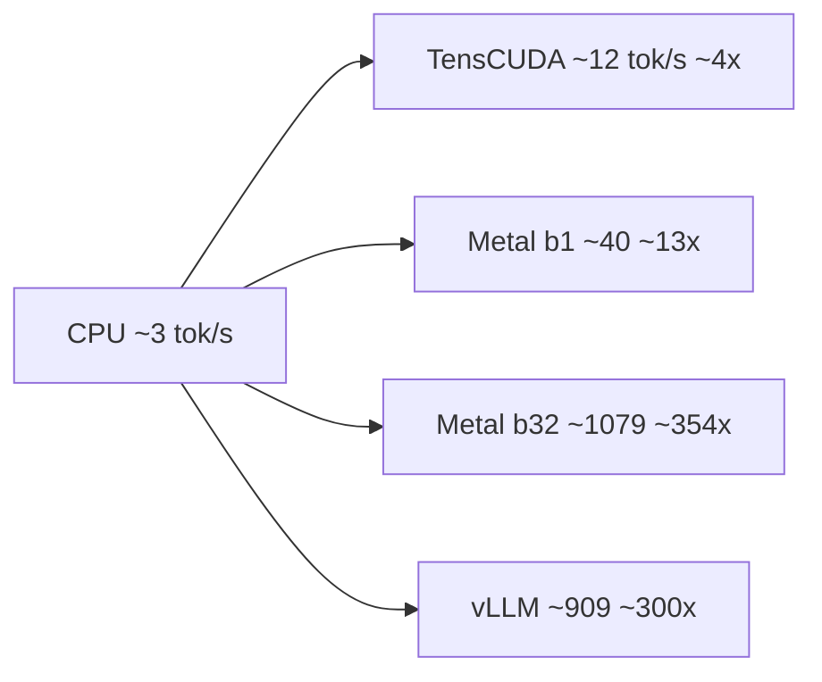

# Speed on one P150 — measured (`tens`, Nov 23, 2026)

**Claim:** on Blackhole P150, **≥100× CPU** token throughput is real — on the **native**
tt-metal / vLLM-TT path with batching, not on TensCUDA’s TT-XLA matrix loop.

TensCUDA remains the HF `.cuda()` **compat** onramp. Do not use its ~4× CPU numbers as the
product speed story.

**Showcase (one command):** `bash scripts/run_tt_speed_showcase.sh` → `results/showcase_*.json`.
Deck / CUDA narrative: [SHOWCASE_CUDA.md](SHOWCASE_CUDA.md).

**Compat vs speed (all tests in git):** [TEST_RESULTS.md](TEST_RESULTS.md) — regenerate with
`python scripts/render_test_results.py` after new `results/*.json`.

## Headlines (Llama-3.1-8B, same card + host)

CPU reference on `tens` (matrix bf16 mmap greedy): **~3.05 tok/s**.

| Path | Metric | Rate | vs CPU | Artifact |
|---|---|---:|---:|---|
| **tt-metal `ttt_compat` batch-32** | aggregate throughput | **1079 tok/s** | **~354×** | [results/tt_metal_b32_speed_2026-11-23T1309.json](../results/tt_metal_b32_speed_2026-11-23T1309.json) |
| **vLLM-TT offline** (256 prompts, max_seqs 32) | tqdm output / peak gen | **~909 / ~927 tok/s** | **~298× / ~304×** | [results/vllm_offline_b32_speed_2026-11-23T1312.json](../results/vllm_offline_b32_speed_2026-11-23T1312.json) |
| tt-metal batch-1 | tok/s/user | **~40.5** | **~13×** | [TT_METAL_FASTPATH.md](TT_METAL_FASTPATH.md) |
| TensCUDA compile (`TENSCUDA_COMPILE=1`) | batch-1 warm | **~11–13** | **~4×** | [COMPATIBILITY.md](COMPATIBILITY.md) |



**100× CPU** means **aggregate** tokens/s (many concurrent sequences). Single-user batch-1
100× (~300 tok/s) is above metal and RTX 3090-class on one P150 — not the target.

## What to run for speed

Separate checkout and venv from TensCUDA (see [TT_METAL_FASTPATH.md](TT_METAL_FASTPATH.md)).
**One job on the card.**

### Metal demo (peak aggregate)

```bash
cd ~/tt-metal && source python_env/bin/activate
export TT_METAL_HOME=~/tt-metal PYTHONPATH=$TT_METAL_HOME
export HF_MODEL=unsloth/Meta-Llama-3.1-8B-Instruct

pytest "models/ttt_compat/demo/simple_text_demo.py::test_demo_text[blackhole-1-device_params0-False-performance-batch-32]" -s
# Expect: === Performance metrics === → ~33.7 tok/s/user, ~1079 tok/s throughput
```

### vLLM-TT offline (serving-shaped)

```bash
cd ~/vllm-tt-plugin && source ~/tt-metal/python_env/bin/activate
export TT_METAL_HOME=~/tt-metal PYTHONPATH=$TT_METAL_HOME
export HF_MODEL=unsloth/Meta-Llama-3.1-8B-Instruct MESH_DEVICE=N150

python examples/offline_inference_tt.py --model "$HF_MODEL" \
  --prompts_json examples/prompts.json --num_repeat_prompts 8 \
  --max_seqs_in_batch 32 --greedy_sampling --max_tokens 128 --max_model_len 8192 \
  --additional-config '{"tt": {"trace_region_size": 67108864}}'
```

Serve + `vllm bench serve`: [scripts/vllm_bench_llama8b_tens.sh](../scripts/vllm_bench_llama8b_tens.sh).

## Reconfirm session (Nov 23 afternoon)

1. Stopped TensCUDA matrix / keep-testing sweeps so the card was free.
2. Metal batch-32 **PASSED** in 33.8 s (hot JIT): TTFT **14.31 ms**, average
   **29.66 ms @ 33.72 tok/s/user (1079.0 tok/s)**. Log: `/tmp/tt_metal_b32_speed.log` on `tens`.
3. vLLM offline completed 256/256 prompts: tqdm **909.34** output tok/s; engine peak gen
   **927.2** tok/s. Log: `/tmp/vllm_offline_b32_speed.log`.

## Related docs

| Doc | Role |
|---|---|
| [TT_METAL_FASTPATH.md](TT_METAL_FASTPATH.md) | Setup, exact pytest node ids, vLLM install |
| [SPEED_RESEARCH.md](SPEED_RESEARCH.md) | CUDA/ROCm playbook → TT map; strategy |
| [PERF.md](PERF.md) | Running log (includes this session’s tables) |
| [COMPATIBILITY.md](COMPATIBILITY.md) | TensCUDA parity / host RSS (not the speed claim) |
| [HARDWARE_BASELINE.md](HARDWARE_BASELINE.md) | Host `tens` specs |

## TensCUDA “more native” (batch-1 ceiling, Nov 23)

TensCUDA cannot reach metal/vLLM **aggregate** throughput without continuous batching.
On the same card, realistic **batch-1** targets:

| Stack | Llama-8B | SmolLM2-135M | Notes |
|---|---:|---:|---|
| **tt-metal / vLLM** | ~40 / **~900+** aggregate | — | Serving path ([above](#what-to-run-for-speed)) |
| **TensCUDA compile (default)** | **~11 tok/s** | **~35 tok/s** | `TENSCUDA_COMPILE` on by default; `=0` for eager |
| **TensCUDA + E4** (`sdpa,rms_norm`) | ~11 tok/s (no ms win) | ~35 tok/s | **32/32** vs compile-only; keep opt-in |

A/B: `scripts/m4_native_compile_ab.py` on `tens` →
`results/m4_native_compile_ab_*.json`. E4 composites are safe for parity; enable with
`export TENSCUDA_NATIVE_OPS=sdpa,rms_norm` (or `TENSCUDA_NATIVE_DEFAULT=1` after a future
faster plugin). Closing the ~11 → ~40 gap needs upstream device kernels / trace, not more Python.

```bash
# Reproduce E4 vs compile on card
PYTHONPATH=. .venv/bin/python scripts/m4_native_compile_ab.py MODEL 32
```

## Non-goals

- Chasing 100× CPU inside TensCUDA TT-XLA for batch-1.
- Treating matrix warm tok/s (~11–13 on 8B compile) as competitive with CUDA/metal serving.
