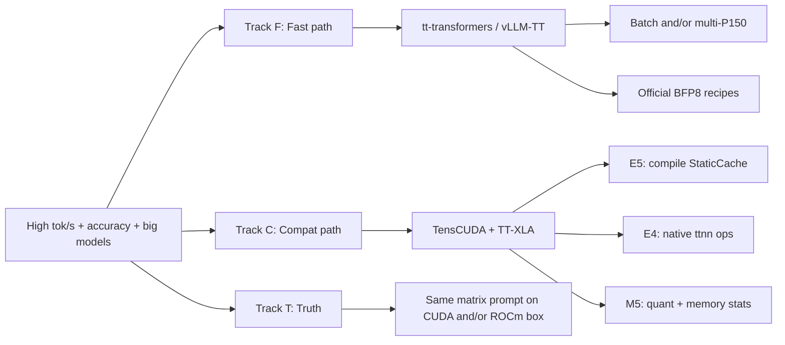

# Speed research: how to get high tok/s + accuracy on big models

> Research note (Nov 23, 2026). Goal: high token volume and accuracy on large models
> on the hardware we have (Blackhole P150), borrowing ideas from CUDA / ROCm / native TT —
> not “port TensCUDA to ROCm.”
>
> **Measured ≥100× CPU on `tens`:** see the short canonical write-up **[SPEED.md](SPEED.md)**
> (metal batch-32 **~354×**, vLLM **~300×**).

## Verdict

**ROCm will not make TensCUDA faster.** It is AMD’s GPU stack. The useful part is the
*playbook* CUDA and ROCm servers use, which Tenstorrent already mirrors in a different stack:

| CUDA / ROCm lever | Tenstorrent equivalent | TensCUDA status |
|---|---|---|
| CUDA Graphs / `cudagraph_mode=FULL` | Compiled decode graph / metal trace / `extract_compiled_graph` | M4 E5 — probe ready, not green yet |
| FlashAttention / AITER FA | Native ttnn SDPA | M4 E4 — `TENSCUDA_NATIVE_OPS` (RMSNorm landed; SDPA opt-in) |
| hipBLASLt / AITER GEMM | ttnn matmul / linear | Compiler lowers some; not forced native |
| FP8 / MXFP | bfp8 / bfp4 weight annotations | Experimental; DRAM savings unmeasurable |
| vLLM continuous batching + paged KV | [vllm-tt-plugin](https://github.com/tenstorrent/vllm-tt-plugin) + tt-transformers | **Not used by TensCUDA** |
| Tensor / data parallel | MESH_DEVICE / QuietBox TP | Vision M7 |

**Biggest finding:** on the **same P150**, Tenstorrent’s **native** path is already an order of
magnitude faster than TensCUDA’s HF + TT-XLA path for supported Llama-class models. TensCUDA is
the *compatibility* onramp; native tt-metal / vLLM-TT is the *throughput* path.

## Numbers (same card class) — vs CPU (~3 tok/s on Llama-8B)

| Path | Model | Metric | Rate | vs CPU |
|---|---|---|---:|---:|
| TensCUDA compile (matrix) | Llama-3.1-8B | batch 1 warm | ~11–13 tok/s | **~4×** — not the speed path |
| TensCUDA (SmolLM2) | 135M | batch 1 warm | ~18–36 tok/s | often **&lt;1×** (host-bound) |
| **tt-metal batch 1** | Llama-3.1-8B | tok/s/u | **~40.5** | **~13×** |
| **tt-metal batch 32** (`tens` reconfirm Nov 23 13:09) | Llama-3.1-8B | **aggregate** | **~1079 tok/s** (~33.7 / user) | **~350×** |
| **vLLM-TT offline b32** (`tens` Nov 23 13:12) | Llama-3.1-8B | aggregate | **~909** (peak gen ~927) | **~300×** |
| tt-metal published | Llama-3.1-8B | b32 aggregate | ~1059 | ~350× |
| RTX 3090 (est.) | Llama-3.1-8B FP16 | batch 1 | ~45–62 | ~15–20× |

**100× CPU target:** met on **aggregate** throughput (metal b32 ~350×). Single-user batch-1
100× (~300 tok/s) is above metal and 3090-class on one P150 — out of scope.

**Verdict:** use **tt-metal / vLLM-TT** for speed. TensCUDA is the HF `.cuda()` compat onramp
(~4× CPU on 8B); do not use its matrix tok/s as the product speed claim.

Interpretation for this project:

- Want **≥100× CPU / hundreds–thousands tok/s** → **batching** on native metal / vLLM-TT.
- Want **fast single-user** on one P150 for Llama-8B → metal `ttt_compat` (~40 tok/s/u), not TT-XLA.
- TensCUDA M4 can still improve compat decode, but it will not replace hand-tuned ttnn for volume.

## What CUDA / ROCm actually teach us

### 1. Capture the decode graph once (CUDA Graphs / ROCm FULL graphs)

AMD’s vLLM guide pushes `compilation-config cudagraph_mode=FULL` (or FULL_DECODE_ONLY) so the
GPU runs a fixed command buffer instead of re-launching from Python every token.

**Our map:** `torch.compile(backend="tt")` + `extract_compiled_graph`, or metal trace
([tt-xla#4220](https://github.com/tenstorrent/tt-xla/issues/4220)). Unlock landed as
`TENSCUDA_COMPILE=1` (CPU-init StaticCache + modes-off capture) — see [M4_LEARNINGS.md](M4_LEARNINGS.md).

### 2. Native attention + GEMM (FlashAttention / AITER)

ROCm’s `VLLM_ROCM_USE_AITER=1` swaps in assembly FA, GEMM, RMSNorm, MoE — often multi× over
generic backends.

**Our map:** M4 E4 — route SDPA / RMSNorm / rotary through documented TT-XLA custom-calls to
ttnn. Do not hand-write metal C++ in this repo ([TT_UPSTREAM.md](TT_UPSTREAM.md) policy).

### 3. Quantization that fits memory bandwidth

CUDA/ROCm: FP8 / AWQ / GPTQ. TT: **bfp8/bfp4** (non-standard; must quantize for TT, not drop
in NVFP4). Register review: QuietBox used BFP8 for Llama 8B/70B. TensCUDA already has
experimental weight annotations; device DRAM savings still blocked by missing
`xm.get_memory_info`.

### 4. Serving, not single-script generate

CUDA and ROCm get “high volume” from **vLLM**: continuous batching, paged KV, chunked prefill,
max-num-batched-tokens sweeps.

**Our map:** [vllm-tt-plugin](https://github.com/tenstorrent/vllm-tt-plugin) + tt-transformers
models (Llama 3.1/3.2, Qwen 2.5, DeepSeek-distill 70B, gpt-oss, …). This is the shortest path
to high aggregate tok/s on Blackhole **without inventing a new adapter**.

### 5. Multi-device for 70B+

70B BFP8 does not fit one P150. CUDA/ROCm use TP/DP/EP; TT uses MESH_DEVICE / QuietBox /
LoudBox TP=4/8. Vision M7 is the TensCUDA multi-chip milestone; native stack already runs it.

## Recommended strategy (accuracy + volume)



### Track F — Fast path (do this for “I want tokens now”)

1. On `tens`, install/run **tt-transformers** batch-1 and batch-32 demos for Llama-3.1-8B;
   record tok/s next to our matrix row (honest A/B on **same card**).
2. If that works, try **vllm-tt-plugin** offline serve for the same model; measure aggregate TPS.
3. For 70B-class: only with multi-chip (or accept “not on one P150”); use TT’s supported list,
   not TensCUDA streaming alone.
4. Prefer TT’s default quant mixes for accuracy; validate with a short greedy parity vs HF CPU
   or vs published references where CPU cannot fit.

### Track C — Compat path (TensCUDA M4+, keep “any `.cuda()` script”)

Priority order already in [M4.md](M4.md):

1. **E5** — land correct `torch.compile(backend="tt")` with upstream StaticCache pattern
   (kills re-trace; largest single TensCUDA lever).
2. **E4** — one native op (SDPA or RMSNorm) via sanctioned hook + parity gate.
3. **Plugin upgrade** — check whether pjrt wheel includes
   `TTIRConsolidateStaticCacheUpdates` (~27% transformers decode recovery upstream).
4. **M5** — bfp8 with measurable device memory once PJRT memory stats exist.
5. Keep accurate softmax/SDPA overrides until fused kernels match parity.

### Track T — Truth (baselines)

- Deferred **NVIDIA same-harness** ref (`results/nvidia_ref_*.json`) — still worth doing.
- Optional **ROCm same-harness** on any AMD GPU box — same script, for a second discrete-GPU
  column. This is comparison only; it does not accelerate the P150.

## What not to do

- Build a “TensROCm” shim — PyTorch ROCm already implements `torch.cuda`.
- Expect TensCUDA HF generate to reach vLLM aggregate thousands of tok/s on one card.
- Turn off accurate softmax for speed without accepting wrong tokens (~13 ms/step on rock).
- Chase 100× single-stream on TT-XLA before graph capture is green (math: sync+exec alone
  caps tiny models near ~30 tok/s on rock-era ms; device path must also get much faster).

## Immediate next experiments (card free, one job at a time)

```bash
# 1) TensCUDA: upstream-aligned compile (compat track)
PYTHONPATH=~/tenscuda .venv/bin/python scripts/m4_compile_staticcache_probe.py \
  HuggingFaceTB/SmolLM2-135M-Instruct 16

# 2) Native TT fast path — see TT_METAL_FASTPATH.md (clone done on tens; needs sudo deps + build)
# cd ~/tt-metal && sudo ./install_dependencies.sh && ./build_metal.sh && ./create_venv.sh
# source python_env/bin/activate && export TT_METAL_HOME=~/tt-metal PYTHONPATH=$TT_METAL_HOME
# export HF_MODEL=unsloth/Meta-Llama-3.1-8B-Instruct
# pytest models/ttt_compat/demo/simple_text_demo.py -k "performance and batch-1"

# 3) Log both into results/ and a short PERF.md § note: TensCUDA vs tt-metal on identical HW
```

## References

- [PERF.md](PERF.md), [M4.md](M4.md), [TT_UPSTREAM.md](TT_UPSTREAM.md), [VISION.md](VISION.md)
- [tt-metal models README](https://github.com/tenstorrent/tt-metal/blob/main/models/README.md)
- [vllm-tt-plugin](https://github.com/tenstorrent/vllm-tt-plugin)
- [ROCm vLLM V1 optimization](https://rocm.docs.amd.com/projects/ai-ecosystem/en/latest/optimization/vllm-v1-optimization.html)
- Register QuietBox review (BFP8, ~50% of peak BW on 8B decode): Nov 2025
