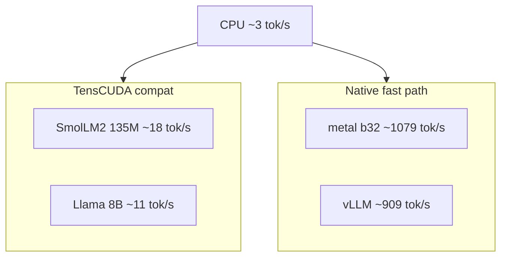

# Test results — speed vs compatibility (`tens`, P150)

*Generated by `scripts/render_test_results.py` — 2026-11-24 03:57 UTC*

This file is the **single index** for measured speed (native + TensCUDA) and
model compatibility. Raw JSON lives in [`results/`](../results/). The full
compatibility table is maintained in [COMPATIBILITY.md](COMPATIBILITY.md).
Per-model **grades** (compat score + native fast-path): [MODEL_SCORES.md](MODEL_SCORES.md).

## Executive summary (Llama-3.1-8B)

CPU greedy reference on this host: **~3.05 tok/s** (bf16 mmap, batch 1).

| Stack | Role | Throughput | vs CPU | vs TensCUDA compile |
|---|---|---:|---:|---:|
| CPU (matrix ref) | baseline | **3.05** tok/s | 1× | — |
| **TensCUDA** (`import tenscuda`, compile default) | HF `.cuda()` compat | **11.09** tok/s | **3.6×** | 1× |
| tt-metal batch-1 | native single-user | **~40** tok/s | **~13×** | **~3.6×** |
| **tt-metal batch-32** | native aggregate | **1080** tok/s | **354×** | **97×** |
| **vLLM-TT offline** (32 seq) | serving-shaped | **908** tok/s | **298×** | **82×** |

**Takeaway:** TensCUDA optimizes for *breadth* (many architectures, 32/32 parity).
**Native metal / vLLM** optimizes for *throughput* (~100× faster than TensCUDA on 8B).

## Native speed tests (committed artifacts)

| Test | Config | Key metric | Artifact |
|---|---|---|---|
| tt-metal `ttt_compat` | batch-32 performance | **1079.0** tok/s aggregate | [`results/tt_metal_b32_speed_2026-11-23T1309.json`](../results/tt_metal_b32_speed_2026-11-23T1309.json) |
| vLLM-TT offline | 256 prompts, b32, 128 new | **908.27** / peak **926.3** tok/s | [`results/vllm_offline_b32_speed_2026-11-24T0357.json`](../results/vllm_offline_b32_speed_2026-11-24T0357.json) |
| vLLM-TT **serve** (`bench serve`) | 32 prompts, OpenAI backend | **137.27** tok/s | [`results/vllm_serve_b32_speed_2026-11-24T0357.json`](../results/vllm_serve_b32_speed_2026-11-24T0357.json) |
| Showcase bundle (metal + vLLM) | — | see JSON | [`results/showcase_2026-11-23T2151Z.json`](../results/showcase_2026-11-23T2151Z.json) |
| TT vs CUDA deck snippet | — | see JSON | [`results/showcase_tt_vs_cuda.json`](../results/showcase_tt_vs_cuda.json) |
| vLLM offline (first full run) | — | see JSON | [`results/vllm_offline_b32_speed_2026-11-23T1312.json`](../results/vllm_offline_b32_speed_2026-11-23T1312.json) |
| E4 compile A/B Llama-8B | — | see JSON | [`results/m4_native_compile_ab_Meta-Llama-3.1-8B-Instruct.json`](../results/m4_native_compile_ab_Meta-Llama-3.1-8B-Instruct.json) |
| E4 compile A/B SmolLM2-135M | — | see JSON | [`results/m4_native_compile_ab_SmolLM2-135M-Instruct.json`](../results/m4_native_compile_ab_SmolLM2-135M-Instruct.json) |

Reproduce: [CUDA_TO_METAL.md](CUDA_TO_METAL.md), [SPEED.md](SPEED.md),
`bash scripts/run_fast_aggregate_measure.sh` or
`run_tt_speed_showcase.sh --skip-metal` after metal if `EngineDeadError`.

## TensCUDA compatibility matrix (warm tok/s vs CPU)

All rows: greedy 32 new tokens, batch 1, streaming load, parity vs CPU reference.
Regenerate table: `python scripts/matrix.py --render`.

| Model | Params | Status | Parity | TT tok/s | CPU tok/s | TT/CPU |
|---|---|---|---|---:|---:|---:|
| SmolLM2-135M-Instruct | 135M | works | 32/32 vs CPU float32 | 18.05 | 38.12 | 0.47× |
| SmolLM2-360M-Instruct | 362M | works | 32/32 vs CPU float32 | 16.60 | 18.59 | 0.89× |
| Qwen2.5-0.5B-Instruct | 494M | works (near-tie) | 16/32 vs CPU float32 | 20.20 | 13.87 | 1.46× |
| TinyLlama-1.1B-Chat-v1.0 | 1.10B | works | 32/32 vs CPU float32 | 17.95 | 8.92 | 2.01× |
| Llama-3.2-1B-Instruct | 1.24B | works | 32/32 vs CPU float32 | 19.27 | 7.91 | 2.44× |
| Qwen2.5-1.5B-Instruct | 1.54B | works | 32/32 vs CPU float32 | 13.17 | 5.27 | 2.50× |
| SmolLM2-1.7B-Instruct | 1.71B | works | 32/32 vs CPU float32 | 14.35 | 5.63 | 2.55× |
| gemma-2-2b-it | 2.61B | works | 32/32 vs CPU float32 | 7.94 | 3.39 | 2.34× |
| Qwen2.5-3B-Instruct | 3.09B | works | 32/32 vs CPU float32 | 8.29 | 3.15 | 2.63× |
| Llama-3.2-3B-Instruct | 3.21B | works | 32/32 vs CPU float32 | 8.89 | 2.91 | 3.05× |
| Phi-3.5-mini-instruct | 3.82B | works (near-tie) | 6/32 vs CPU float32 | 6.89 | 2.54 | 2.71× |
| mistral-7b-instruct-v0.3 | 7.25B | works (near-tie) | 4/32 vs CPU bfloat16 | 12.92 | 3.28 | 3.94× |
| Qwen2.5-7B-Instruct | 7.62B | works | 32/32 vs CPU bfloat16 | 12.90 | 3.35 | 3.85× |
| Meta-Llama-3.1-8B-Instruct | 8.03B | works | 32/32 vs CPU bfloat16 | 11.09 | 3.05 | 3.64× |
| gemma-2-9b-it | 9.24B | works | 32/32 vs CPU bfloat16 | 3.81 | 2.35 | 1.62× |

### Compatibility vs speed (patterns)

- **Small models (≤1.7B):** often **TT &lt; CPU** on this host-bound TT-XLA path
  (e.g. SmolLM2-135M **18 vs 38 CPU tok/s**). Compat wins, not speed.
- **3B–8B:** TT **beats CPU** (~3–4× on 8B compile) but stays **~100× below**
  native batch-32 serving.
- **Near-tie parity:** Qwen2.5-0.5B, Phi-3.5-mini, Mistral-7B — see notes in
  [COMPATIBILITY.md](COMPATIBILITY.md); not speed regressions.

## TensCUDA native-op experiment (M4 E4)

`TENSCUDA_NATIVE_OPS=sdpa,rms_norm` vs compile-only — **32/32** tokens, **no** decode win:

| Model | compile ms | + native ms |
|---|---:|---:|
| SmolLM2-135M | 28.8 | 28.7 |
| Llama-3.1-8B | 90.0 | 90.3 |

## `results/` speed artifact index

| File | Kind |
|---|---|
| `showcase_2026-11-23T2151Z.json` | Showcase bundle (metal + vLLM) |
| `showcase_tt_vs_cuda.json` | TT vs CUDA deck snippet |
| `tt_metal_b32_speed_2026-11-23T1309.json` | tt-metal batch-32 pytest |
| `vllm_offline_b32_speed_2026-11-23T1312.json` | vLLM offline (first full run) |
| `m4_native_compile_ab_Meta-Llama-3.1-8B-Instruct.json` | E4 compile A/B Llama-8B |
| `m4_native_compile_ab_SmolLM2-135M-Instruct.json` | E4 compile A/B SmolLM2-135M |
| `vllm_offline_b32_tens_2026-11-23.json` | Hand-recorded vLLM summary |
| `vllm_offline_b32_speed_2026-11-23T2222.json` | vLLM offline (additional run) |
| `vllm_offline_b32_speed_2026-11-24T0357.json` | vLLM offline (additional run) |
| `vllm_serve_b32_speed_2026-11-24T0357.json` | vLLM serve bench |
